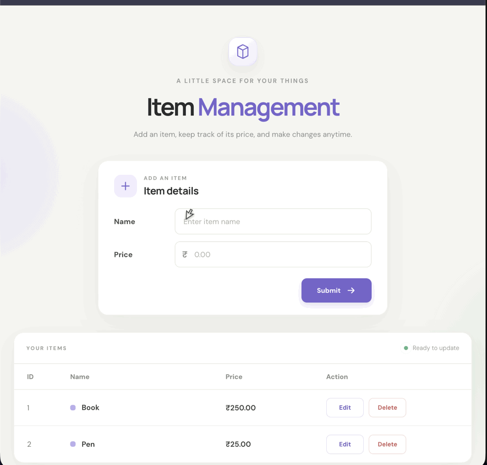
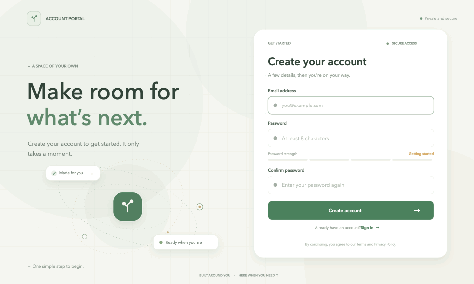

# Mern_Lab_task
# Web Development Projects — Task 1 & Task 2

This repository brings together two web development projects: a CRUD items app and a polished signup/login experience.

| Task | Project | What it does | Data storage |
| --- | --- | --- | --- |
| 1 | MERN CRUD Lab | Create, view, update, and delete items through an Express REST API. | In-memory JavaScript array; resets when the server restarts. |
| 2 | Garden Signup Portal | Responsive, animated signup and login UI connected to an Express authentication API. | MongoDB Atlas via Mongoose; passwords are hashed by the backend. |

> **Storage note:** Task 1 is a CRUD practice app and does not currently use MongoDB, despite “MERN” in its name. Task 2 uses MongoDB through its separate signup API.

## Animated Previews

### Task 1 — MERN CRUD Lab



### Task 2 — Garden Signup Portal



## Task 1 — MERN CRUD Lab

A simple CRUD application with a vanilla HTML/CSS/JavaScript frontend and an Express.js REST API.

### Features

- List, create, edit, and delete items.
- REST endpoints: `GET /api/items`, `POST /api/items`, `PUT /api/items/:id`, and `DELETE /api/items/:id`.
- Example starting items: Book (250) and Pen (25).

### Run

```sh
cd mern-crud-lab
npm install
npm start
```

Open <http://localhost:3000>.

## Task 2 — Garden Signup Portal

A responsive React signup/login experience with animated graphics, password-strength feedback, password visibility controls, and form validation. The frontend calls `/api/auth/signup` and `/api/auth/login`.

### Run

The Express/Mongoose backend must run separately on port `5001`. Configure its private `.env` with `MONGODB_URI` and `PORT=5001`; never commit that file or put the MongoDB URI in frontend settings.

Start the backend in one terminal:

```sh
cd /path/to/signup-project/backend
npm install
npm run dev
```

After it reports a successful MongoDB connection, start the frontend in another terminal:

```sh
cd garden-signup-source
npm install
npm run dev
```

Open the local URL printed by Vite. During local development, Vite proxies `/api` requests to `http://localhost:5001`. For a deployed backend, set `VITE_API_URL` to its base URL.

